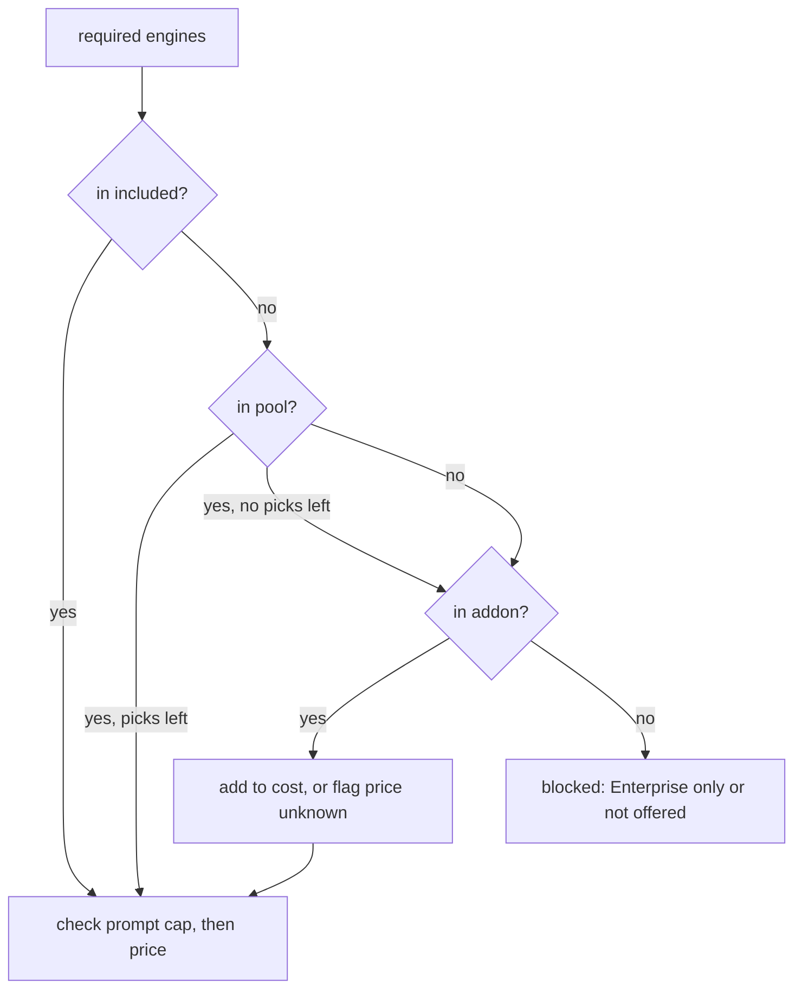

# Best Peec AI Alternatives

<p align="center">
  <a href="https://aiclicks.io/">
  </a>
</p>

Most lists of [Peec AI alternatives](https://aiclicks.io/blog/best-peec-ai-alternatives) compare engine counts copied from pricing pages. That number does not decide anything. What decides it is whether a plan covers the specific engines your buyers use, at your prompt volume, without a sales call, and what it costs once the add ons are in. That is a constraint problem, so this repo treats it as one.

It ships three small Python scripts and one data file. `engine_diff.py` tells you which engines are worth tracking at all, from a handful of manual checks. `solve.py` takes that engine list plus a prompt count and returns the cheapest self serve plan per tool that satisfies it, or the exact engine that blocks it. `peec_credits.py` models Peec's agency credit pool, for teams deciding whether to stay. All plan facts live in [tools.yaml](tools.yaml) and both README tables are generated from it.

```
.
├── tools.yaml              14 tools, every self serve plan, engines per plan
├── solve.py                engines + prompts -> cheapest plan per tool
├── engine_diff.py          manual checks CSV -> which engines actually differ
├── peec_credits.py         Peec agency credit allocation planner
├── render_table.py         tools.yaml -> README tables, --write, --check
├── examples/
│   ├── manual-checks.example.csv   5 prompts x 6 engines, fictional brands
│   └── clients.example.csv         6 client agency roster
├── tests/                  unittest, no network
└── .github/workflows/      table check, tests, link check
```

## Quick start

```bash
pip install pyyaml
python engine_diff.py examples/manual-checks.example.csv
python solve.py --engines chatgpt,claude,gemini,perplexity --prompts 100
python solve.py --list-engines
```

Python 3.9 or newer. PyYAML is the only dependency.

## Where Peec AI stops

Peec is a well built tracker and for plenty of teams it is the right one. Three limits show up again and again in the reasons people go looking for an alternative, and all three are mechanical rather than a matter of taste.

**Model slots.** Every brand plan (Starter $95, Pro $245, Advanced $495 per month, at 50, 150 and 350 prompts) lets you choose 3 models from ChatGPT, AI Mode, AI Overviews, Copilot, Gemini, Perplexity and Naver AI. A fourth model from that list is an add on. Claude, Grok, DeepSeek, Qwen, Mistral and Meta are collected through their APIs and sit on Enterprise only. If your buyers ask Claude, no brand plan upgrade fixes it. A dedicated [Claude rank tracking](https://aiclicks.io/trackers/claude-ai-tracker) setup or a different vendor does.

**Actions ends at a ranked list.** Peec's Actions feature groups cited sources into clusters, scores each opportunity from 1 to 3 and splits the result into on page and off page work. It is included on every plan and it is better than what most trackers ship. Peec is also clear that you create the content yourself. A team with a writer and someone doing outreach will be fine with that. A team of one ends up with a second backlog.

**Agency credits are a capacity plan.** Agency plans sell a pool (10,000, 25,000 or 65,000 credits) where 1 prompt on 1 model for 1 day costs 1 credit, with a 900 credit floor per project. Adding one model to one client reprices that client against the shared pool. The arithmetic is simple but someone has to keep doing it, which is why `peec_credits.py` exists.

## Step 1: find the engines that disagree

Thirteen engines on a pricing page are worth nothing if eight of them recommend the same brands for your category. Before comparing any tool, run five to ten buying intent prompts by hand on each engine and log the brands each answer names:

```csv
prompt,engine,brands
best crm for a 10 person startup,chatgpt,Acme CRM|Northwind|Globex|Initech
best crm for a 10 person startup,copilot,Acme CRM|Northwind|Globex|Hooli
```

`engine_diff.py` averages the Jaccard overlap of brand lists for every engine pair, then picks engines greedily, most distinct first, and drops any engine whose answers mirror one already picked (default threshold 0.7). On the bundled sample:

```
                     aio     chatgpt      claude     copilot      gemini  perplexity
aio                 1.00        0.54        0.16        0.58        0.83        0.18
chatgpt             0.54        1.00        0.34        0.87        0.39        0.24
claude              0.16        0.34        1.00        0.27        0.09        0.21
copilot             0.58        0.87        0.27        1.00        0.43        0.23
gemini              0.83        0.39        0.09        0.43        1.00        0.11
perplexity          0.18        0.24        0.21        0.23        0.11        1.00

skip aio: mirrors gemini
skip copilot: mirrors chatgpt

keep 4 of 6 engines

python solve.py --engines chatgpt,claude,gemini,perplexity --prompts 50
```

The sample brands are fictional and the overlap is planted so the output is easy to read. Your own numbers will be messier. A pair sitting at 0.6 on five prompts is worth five more prompts before you decide.

## Step 2: solve for the cheapest plan that fits

The last line of step 1 is a ready command. Here it is with 100 prompts, which is the requirement this README is built around: ChatGPT, Claude, Gemini and Perplexity, all on a self serve plan.

<!-- FIT:START -->
```bash
python solve.py --engines chatgpt,claude,gemini,perplexity --prompts 100
```

| Tool | Cheapest plan that fits | Monthly | Note |
| --- | --- | --- | --- |
| Rankscale AI | Pro | €99 | prompt volume set by credits or config |
| PromptMonitor | Pro | $149 |  |
| AIclicks | Pro | $189 |  |
| AthenaHQ | Self Serve | $295 | prompt volume set by credits or config |
| AI Rank Checker | Wallet | usage priced | prompt volume set by credits or config |
| AI Peekaboo | Configurable | $29 + add ons | add on: Claude, add on price not published, prompt volume set by credits or config |
| Otterly AI | Standard | $189 + add ons | add on: Claude, Gemini, add on price not published |
| Ahrefs Brand Radar | none | n/a | Claude not offered |
| Gauge | none | n/a | Claude, Gemini, Perplexity Enterprise only |
| Geneo | none | n/a | Claude, Gemini not offered |
| Peec AI | none | n/a | Claude Enterprise only |
| Profound | none | n/a | Claude, Gemini Enterprise only |
| Scrunch AI | none | n/a | Claude, Gemini Enterprise only |
| Writesonic | none | n/a | Claude, Perplexity Enterprise only |
<!-- FIT:END -->

Seven of fourteen tools cannot meet this requirement on any self serve plan, and in every case Claude is one of the reasons. Rows with a fixed price sort first, then rows whose final price depends on an unpublished add on or on usage, then the misses. Prices stay in the vendor's own currency, so the euro row is not converted.

Drop Claude from the list and the picture changes: `--engines chatgpt,perplexity,gemini,aio --prompts 40` puts AI Peekaboo at $29, PromptMonitor Growth at $79 and Peec Starter at $95 plus one add on. That swing is the whole argument for doing step 1 first.

### How the solver decides

Each plan in `tools.yaml` describes engines in four buckets, and `fit_plan` checks them in order.



`included` engines come with the plan. `pool` plus `choose` models the pick N of M design that Peec and AIclicks use. `addon` engines cost extra, at `addon_price` each, capped at `addon_bundle` where a vendor sells a bundle (Ahrefs prices six indexes at $699 instead of six times $199). Anything left over is blocked, and the tool's `enterprise` list decides whether the note says "Enterprise only" or "not offered". An engine counts as blocked only if no self serve plan of that tool offers it, so a cheap plan's gap is never reported as the tool's gap.

## The data

<!-- TABLE:START -->
| Tool | Entry plan | Price | Prompts | Engines on entry plan | Claude | After the data | Facts from |
| --- | --- | --- | --- | --- | --- | --- | --- |
| [Peec AI](https://peec.ai/pricing) | Starter | $95 | 50 | pick 3 of 7 | Enterprise only | Ranks opportunities | vendor pricing page, 30 October 2026 |
| [AIclicks](https://aiclicks.io/pricing) | Starter | $59 | 30 | pick 3 of 13 | one of your picks (Starter) | Ships work | vendor pricing page, 30 October 2026 |
| [AI Rank Checker](https://airankchecker.net/) | Wallet | usage priced | credits or config | 7 | included (Wallet) | Reports | AIclicks roundup, not rechecked |
| [AI Peekaboo](https://aipeekaboo.com/pricing) | Configurable | $29 | credits or config | 5 + 2 add on | add on (Configurable) | Reports | vendor page for engines 30 October 2026, roundup for price |
| [Profound](https://www.tryprofound.com/pricing) | Starter | $99 | 50 | 1 | Enterprise only | Reports | AIclicks roundup, not rechecked |
| [Scrunch AI](https://scrunch.com/pricing) | Core | $250 | 125 | 4 | Enterprise only | Reports | AIclicks roundup, not rechecked |
| [AthenaHQ](https://www.athenahq.ai/pricing) | Self Serve | $295 | credits or config | 8 | included (Self Serve) | Ships work | AIclicks roundup, not rechecked |
| [Writesonic](https://writesonic.com/pricing) | Starter | $79 | 50 | 3 | Enterprise only | Ships work | AIclicks roundup (annual billing prices), not rechecked |
| [Otterly AI](https://otterly.ai/pricing) | Lite | $29 | 15 | 4 + 3 add on | add on (Lite) | Ranks opportunities | vendor page for engines and Lite 30 October 2026, roundup for upper tiers |
| [PromptMonitor](https://promptmonitor.io/pricing) | Starter | $39 | 25 | 3 | included (Growth) | Reports | vendor pricing page, 30 October 2026 |
| [Rankscale AI](https://rankscale.ai/pricing) | Pro | €99 | credits or config | 10 | included (Pro) | Reports | AIclicks roundup, not rechecked |
| [Gauge](https://www.withgauge.com/pricing) | Growth | $599 | 600 | 3 | Enterprise only | Ships work | vendor pricing page, 30 October 2026 |
| [Geneo](https://geneo.app/) | Pro | $39.90 | credits or config | 3 | not offered | Ranks opportunities | AIclicks roundup, not rechecked |
| [Ahrefs Brand Radar](https://ahrefs.com/brand-radar) | Lite plus indexes | $129 | credits or config | 6 as add ons | not offered | Reports | AIclicks roundup, not rechecked |
<!-- TABLE:END -->

"After the data" is what a self serve plan does once answers are collected. **Reports** means dashboards and exports. **Ranks opportunities** means a scored list of what to do next that your team then executes. **Ships work** means the plan produces drafts, tasks or outreach targets inside the product. Review scores were left out on purpose.

Two rows disagree with the roundup this repo is adapted from, because the vendor pages said otherwise on 30 October 2026. PromptMonitor's Starter is $39 for 25 prompts on ChatGPT, Gemini and Perplexity only, and the eight model list starts at Growth ($79). Gauge's $599 Growth plan covers ChatGPT, AI Mode and Copilot, with the other core platforms on Enterprise and Claude or Grok only through your own API keys.

## Notes on each tool

**AIclicks.** An [AI search visibility](https://aiclicks.io/) platform that pairs tracking with an action layer split into content to create, sources to earn mentions on and communities to engage in. Starter is $59 for 30 prompts and 3 models picked from 13, Pro is $189 for 150 prompts and 4 models with API, MCP and GA4, Business is $499 for 300 prompts and 6 models. The pricing page labels Claude, Grok, Perplexity, Mistral, DeepSeek, Qwen and Meta as API collected. Note that "10+ engines" describes the pool, not what one plan runs at once, and the solver models it that way. 3 day trial. This repo is adapted from AIclicks' own roundup, see credits.

**AI Rank Checker.** A prepaid wallet with no subscription, covering ChatGPT, Gemini, Claude, Perplexity, AI Mode, AI Overviews and Grok. It answers "where do we stand today" and stops there, with no citation analysis or trend history. Good for a quarterly check, expensive as a daily habit.

**AI Peekaboo.** Configurable pricing from about $29 a month, set by prompts, models and refresh frequency. ChatGPT, Gemini, Perplexity, AI Overviews and AI Mode are core, Claude and Copilot are add ons. API and MCP access on paid plans is the reason engineers shortlist it.

**Profound.** Starter is $99 for ChatGPT only. Growth at $399 adds Perplexity and AI Overviews. Gemini, Claude and the rest, plus the content Agents, sit on Enterprise. Its Prompt Volumes dataset is unusual in the category and is the main reason to pay Enterprise prices.

**Scrunch AI.** Core is $250 for 125 prompts across ChatGPT, Perplexity, AI Overviews and Copilot. The distinctive part is AXP, which detects AI crawlers at the CDN edge (Akamai, Cloudflare, Vercel) and serves them a structured version of the site. Engine coverage on Core is narrower than Peec's pool.

**AthenaHQ.** $295 a month self serve with eight engines included, Claude among them, and an Action Center that assigns tasks. Shopify and GA4 revenue attribution is the selling point. No free trial, and API access is Enterprise.

**Writesonic.** Tracking bolted onto a content suite. Self serve plans track ChatGPT, Gemini and AI Overviews only, with full coverage on Enterprise. Makes sense when article volume is the real goal.

**Otterly AI.** Lite at $29 tracks 15 prompts on ChatGPT, AI Overviews, Perplexity and Copilot, with Claude, AI Mode and Gemini sold as add ons. Fast setup and scheduled reports. The solver flags it as "+ add ons" because the add on prices are not on the page.

**PromptMonitor.** Pulls author emails, social profiles and domain metrics for cited sources, which shortens outreach research. Growth at $79 tracks eight models daily. Prompt caps are tight at 25, 50 and 150.

**Rankscale AI.** Credit based, from €99, with the widest engine list here on every plan. Dense interface, and credit budgeting takes a few weeks to calibrate. Good for checking whether a long tail engine matters at all before paying elsewhere.

**Gauge.** $599 Growth with 600 daily prompts, a content engine writing 18 articles a month and a ChatGPT ads tracker. Only three platforms on Growth. Built for teams that have already committed budget to the channel.

**Geneo.** White label client portals on your own domain from $129 on agency plans. ChatGPT, Perplexity and AI Overviews only. The delivery layer is the product.

**Ahrefs Brand Radar.** A research tool rather than a tracker: it reads a large index of search backed prompts instead of a list you write. Needs an Ahrefs plan from $129, plus $199 per AI index or $699 for all six, so roughly $828 for full coverage. No Claude.

## Staying on Peec: plan the credit pool

If step 2 says Peec still fits, or you run an agency and are weighing the switch, model the pool first. Put the roster in a CSV with `client,prompts,models`:

```
$ python peec_credits.py examples/clients.example.csv --plus-model globex-saas
client                 prompts  models  credits
acme-dental                 60       3    5,400
northwind-legal             40       3    3,600
globex-saas                120       4   14,400
initech-hr                  25       3    2,250
umbrella-clinics            80       3    7,200
hooli-fintech               10       2      900  (900 minimum)
total                                    33,750

fits Scale (65,000), 31,250 credits of headroom = 347 more prompts at 3 models

with one more model on globex-saas:
...
total                                    37,350
```

Six clients already pass the 25,000 Growth pool, and one extra model on the largest client costs 3,600 credits by itself. The rules in the script come from Peec's agency pricing page and are listed in its docstring.

## FAQ

### What are the best Peec AI alternatives?

It depends on the engines you need, which is the point of this repo. For ChatGPT, Claude, Gemini and Perplexity at 100 prompts, the self serve options are Rankscale, PromptMonitor, AIclicks, AthenaHQ and AI Rank Checker, with AI Peekaboo and Otterly reaching it through add ons. Run `solve.py` with your own list to get your own answer.

### Which alternatives to Peec AI track Claude without Enterprise?

AIclicks (as one of your picks), AthenaHQ, PromptMonitor from Growth, Rankscale and AI Rank Checker include it. AI Peekaboo and Otterly sell it as an add on. Peec, Profound, Scrunch, Writesonic and Gauge keep it behind Enterprise or your own API keys.

### What is the cheapest of the best alternatives to Peec AI?

On list price, AI Peekaboo and Otterly Lite start at $29 and PromptMonitor at $39. Cheapest for your requirement is a different question, because add ons and prompt caps move the number. That is what the Monthly column in step 2 computes.

### Does a higher engine count mean better coverage?

Only if those engines give different answers in your category. In the sample data, Copilot mirrors ChatGPT and AI Overviews mirrors Gemini, so four engines carry all the signal of six. Measure that with `engine_diff.py` before paying for breadth.

## Contributing and credits

Prices and plans change every few months. Fix a fact in [tools.yaml](tools.yaml) with a link to the vendor page, run `python render_table.py --write` and open a pull request. CI fails if the tables and the data disagree. Details in [CONTRIBUTING.md](CONTRIBUTING.md).

The shortlist is adapted from the AIclicks roundup of the [best Peec AI alternatives](https://aiclicks.io/blog/best-peec-ai-alternatives). AIclicks is featured and that is disclosed here. Peec AI, AIclicks, PromptMonitor, Gauge, Otterly and AI Peekaboo plan facts were rechecked on their pricing pages on 30 October 2026, and the "Facts from" column says which rows were not. The solver, the engine overlap method, the credit planner and the sample data are original to this repo. Confirm prices with each vendor before buying.

## License

MIT. See [LICENSE](LICENSE).
